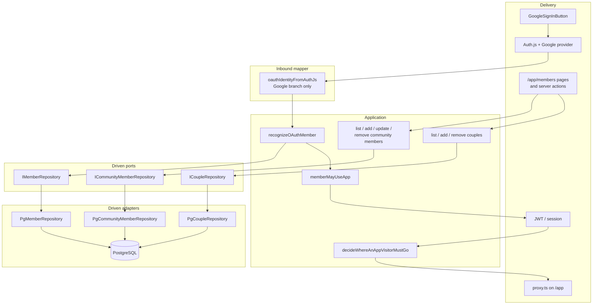
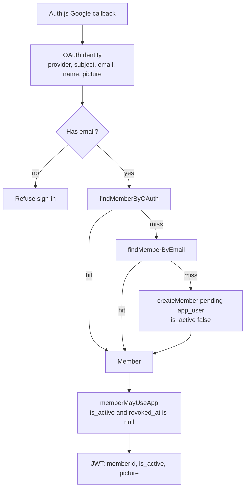
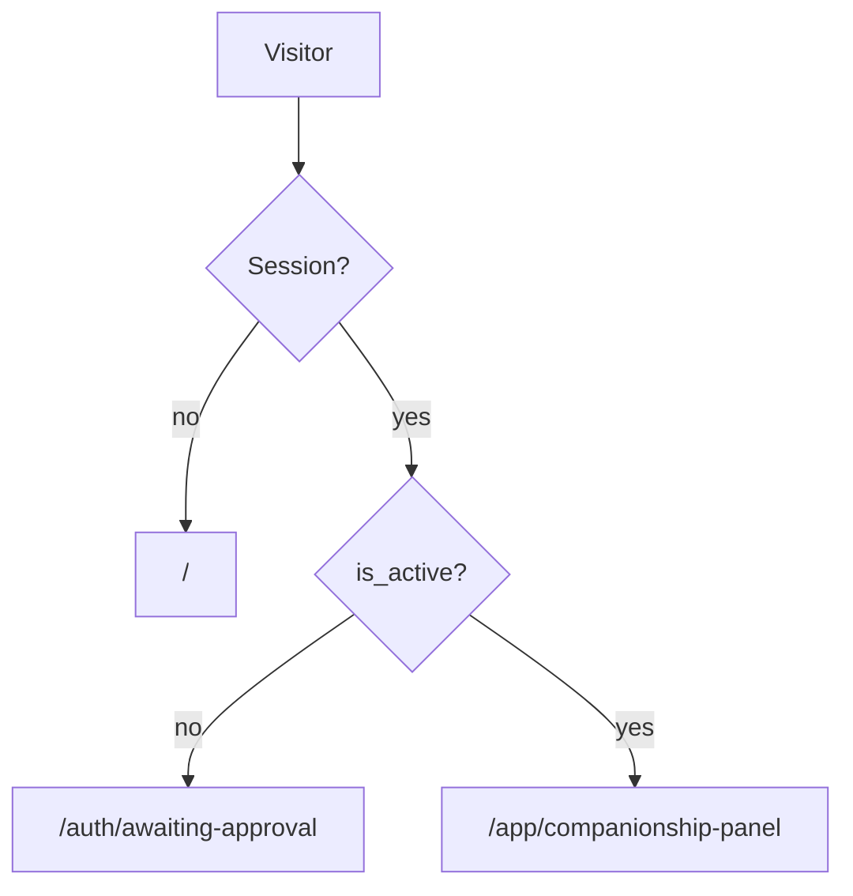
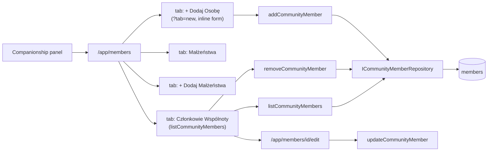
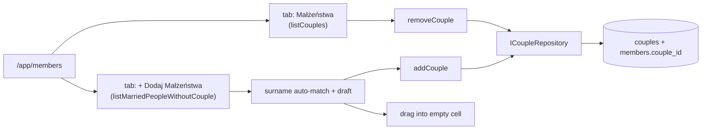
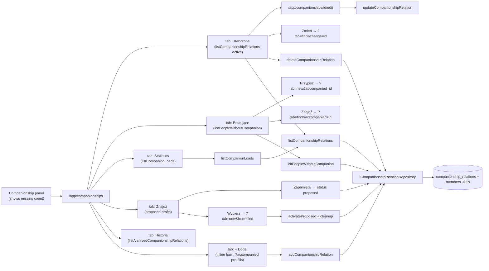
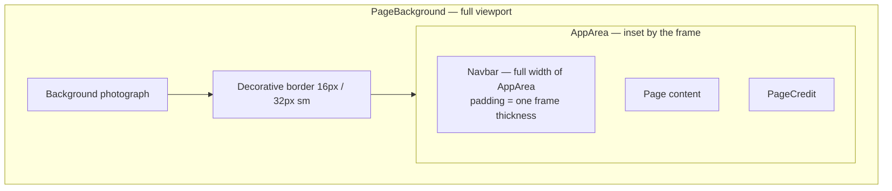
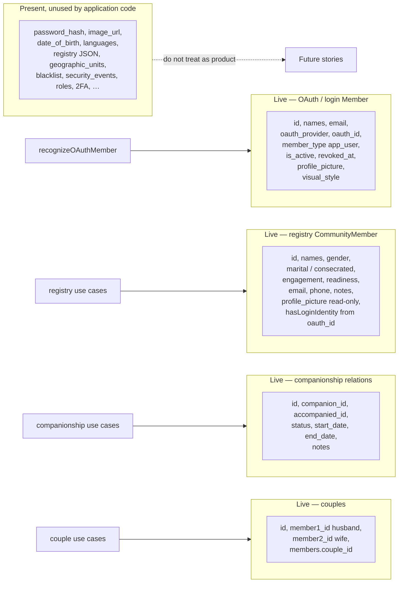

# Current architecture

How emmaCompanionship is built **today**, and why. Domain rules live in [application_idea.md](./application_idea.md); this file is the implementation map.

## Stack and why

| Choice | What we use | Why |
|---|---|---|
| Web | Next.js 16 App Router, React 19, TypeScript | Server-side session and routing; one repo for UI and auth callbacks |
| Auth delivery | Auth.js v5 (`next-auth@beta`), Google provider only | OAuth redirect, cookies, JWT — not our job to reimplement |
| Persistence | `pg` + raw SQL in `db/migrations/` | No Prisma. SQL stays reusable if another backend appears |
| Database | PostgreSQL 16 in Docker | Local, scripted via `npm run db:*` |
| UI | Tailwind CSS 4, motion | Existing look; decorative frame around a dark inner stage |
| Tests | Vitest | Fast unit tests for recognition, routing, registry writes, and operator copy |

Deliberately **not** in the live path: Nx, Prisma, Jest, Argon2/password login, Facebook, an `IOauthLogin` port wrapping Auth.js.

Grow the tree from working slices. Do not restore archived “production-grade” structure before a feature needs it. The reason we refuse that path (twice already) is [organic-growth.md](./organic-growth.md).

## Hexagon

Auth.js is the **inbound adapter** (browser → Google → callback). The application starts after someone has been confirmed. Persistence is a **driven port**.



**Why there is no `IOauthLogin` port.** Confirming identity at Google, holding cookies, and signing the JWT is delivery. Wrapping Auth.js would be hexagonal theater. A later GitHub or Facebook provider is another mapper branch plus an Auth.js provider — not a second use case.

**Four ports across three tables.** Login is `Member`. Registry is `CommunityMember`. Companionship is `CompanionshipRelation`. Couples are `Couple`. Do not hang list/update/delete on the OAuth port, and do not hang Google recognition on the registry port. Do not hang companionship or couples on member CRUD.

| Port | Type | What it does |
|---|---|---|
| `IMemberRepository` | `Member` | `findMemberById` / `findMemberByEmail` / `findMemberByOAuth` / `createMember` (scoped to `member_type = 'app_user'`). Also `updateMemberVisualStyle` for the signed-in person’s look. |
| `ICommunityMemberRepository` | `CommunityMember` | `listCommunityMembers` / `findCommunityMemberById` / `findCommunityMemberByEmail` / `addCommunityMember` / `updateCommunityMember` / `removeCommunityMember`. Lists **every** row. Writes omit OAuth, password, `is_active`, approval, `member_type`, and `profile_picture`. |
| `ICompanionshipRelationRepository` | `CompanionshipRelation` / `CompanionshipRelationListItem` / `PersonWithoutCompanion` | `listCompanionshipRelations` (active) / `listArchivedCompanionshipRelations` / `listProposedCompanionshipRelationsForAccompanied` / `findCompanionshipRelationById` / `findActiveCompanionshipRelationByAccompaniedId` / `addCompanionshipRelation` / `updateCompanionshipRelation` / `archiveActiveCompanionshipRelation` / `deleteProposedCompanionshipRelation` / `activateProposedCompanionshipRelation` / `deleteCompanionshipRelation` / `listPeopleWithoutCompanion`. Manages accompaniment tracking on `companionship_relations`. `listPeopleWithoutCompanion` excludes only people with an **active** `accompanied_id` row (`proposed` does not block Missing). Use cases own companionship transactions: couple add/edit/proposal/activate/remove and Companion change compose these singular calls inside `IAtomicWork.runAsAtomic` (`PgAtomicWork`; `InMemoryCompanionshipRegistry` in tests). Singular repository calls join the open block through `PgCurrentClient`, otherwise they run on the pool. Blocks do not nest. |
| `ICoupleRepository` | `Couple` / `CoupleListItem` / `MarriedPersonWithoutCouple` | `listCouples` / `listMarriedPeopleWithoutCouple` / `findCoupleById` / `addCouple` / `removeCouple`. Manages `couples` plus both spouses’ `members.couple_id`. `member1_id` = husband (male), `member2_id` = wife (female). List sorts by husband’s then wife’s last name. Unpaired pool: `marital_status = 'married'`, gender set, `couple_id` null. |

`hasLoginIdentity` is derived from `oauth_id`; it is not a column. Registry inserts leave `member_type` unset so Postgres defaults to `'companion'`. Dropping `member_type` is a later login-identity story, not a form story.

## Auth behavior

### Recognize, then session



`recognizeOAuthMember` is provider-agnostic. Google is hardcoded only in `oauthIdentityFromAuthJs`.

The logout control shows the Google face from the JWT `picture`, then the stored `profile_picture` if the token has none. `` is required for Google avatar URLs.

### After sign-in, where they go

`/auth/continue` and `src/proxy.ts` (matcher `/app/:path*`) use the same idea: no session → home; `is_active` → stay on `/app` (continue sends approved members to the panel); otherwise awaiting-approval.



| Route | Who sees it |
|---|---|
| `/` | Signed-out landing; Google control |
| `/auth/continue` | Post-OAuth fork |
| `/auth/awaiting-approval` | Signed in, not approved |
| `/auth/error` | Sign-in failed; public copy has no npm/DB details |
| `/app/companionship-panel` | Approved member; **Członkowie wspólnoty**, **Akompaniamenty** (with missing count and overwhelmed-Companions count), Health Dashboard stub, **Ustawienia aplikacji** |
| `/app/members` | Four tabs: **Członkowie Wspólnoty** (list), **Małżeństwa** (`?tab=couples`), **+ Dodaj Małżeństwa** (`?tab=build-couples`), **+ Dodaj Osobę** (`?tab=new`) |
| `/app/members/new` | Redirects to `/app/members?tab=new` |
| `/app/members/[id]/edit` | **Edytuj**; missing id → 404 |
| `/app/companionships` | Six tabs: **Utworzone Akompaniamenty** (default, active), **Brakujące Akompaniamenty** (`?tab=missing`), **Statistics** (`?tab=statistics`, Overwhelmed Companions chart), **Znajdź Akompaniatora** (`?tab=find`), **Historia Akompaniamentów** (`?tab=history`, archived, read-only), **+ Dodaj Akompaniament** (`?tab=new`); `?accompanied=<id>` pre-fills Accompanied on Find or Dodaj; `?change=<relationId>` opens Find with Accompanied locked (Zmień); `?from=find` on Dodaj locks both sides and activates the chosen proposal on Zapisz |
| `/app/companionships/new` | Redirects to `/app/companionships?tab=new` (preserving `?accompanied`) |
| `/app/companionships/[id]/edit` | **Edytuj akompaniament**; missing id → 404 |

**Approval today** is not an admin screen. Create happens pending. An operator sets `members.is_active = true` (e.g. DBeaver). JWT fields are set at sign-in, so the member **must sign in again** after the flip (and after a `profile_picture` change).

**Errors.** `[emma]` logs may say `npm run db:start`. The public page does not. Local extra sentence when `OPERATOR_HINTS=1` or `NODE_ENV === 'development'`.

### How texts get translated

Every user-visible string lives in `src/i18n/messages/<language>-<COUNTRY>.json` (flat keys named by meaning). English is the base and the fallback; Polish is the second language. The `emma-language` cookie, set from the navbar dropdown, chooses the language; routes do not change. The root layout reads the cookie and gives the merged messages to `LocaleProvider`; client components call `useTranslate()`, server components `currentTranslator()`. Server actions never return sentences: they return `messageRef(key, values)` and the form or button translates it. Enum values and other stored values stay English; only their labels translate, and lists sort by the words shown, collated by the chosen language, so switching language can reorder a list. The language list is discovered from the files in that folder when the app is built, so adding a language means adding one file; follow [translating.md](./translating.md).

## Community registry

An approved member opens **Członkowie wspólnoty** and works people as registry entities. This slice does not turn them into login users. Google login stays the only way a row becomes an app identity.



- Required on write: `first_name`, `last_name`. `accompanying_readiness` defaults to `'Not Candidate'` in application code.
- Email is optional. If present it must look like an email and be unique across **all** member types (application check; the partial unique index stays `app_user`-only).
- Enum values match the SQL CHECKs, including the stored spelling `Commited`. Labels come from the message files; stored values stay English.
- Consecrated-type is offered only when marital status is `consecrated`.
- **Usuń** is a hard `DELETE` and only when `!hasLoginIdentity`. A login row shows a hint, not a delete control. A FK block shows a sentence with no table names.
- The list loads every in-scope row in one query (no pagination). Cards below the `lg` breakpoint, a table from `lg`. Imię and nazwisko stay visible; other columns are optional. Sort and shown fields live in `localStorage`. The table face is the Google `profile_picture` URL, not `image_url` (unused Base64).

## Couples

An approved member opens **Członkowie wspólnoty** and uses the marriage tabs. Couples are registry links only — companionship still names two people, not a couple.



- Schema: `couples(id, member1_id, member2_id, timestamps)`. No `wedding_date` / `number_of_children` (`002_couples_drop_unused_columns.sql`; `001_init.sql` matches for fresh DBs).
- Add writes the couple row and sets both `members.couple_id` in one transaction. Remove deletes the couple; `members.couple_id` becomes null via `ON DELETE SET NULL`. Does **not** change `marital_status`.
- Builder pool: married + gender male/female + not already in a couple. Missing gender stays out until person edit.
- Auto-pair only when a surname match-group has exactly one male and one female. Surnames match after Polish lowercasing when equal or when they differ only by the last letter. Larger groups stay single-side rows for manual drag.
- ✓ confirms to DB; ✕ splits the proposal and remembers the rejected pair in `localStorage` (`emma.couple-builder.draft`) so reload does not rematch. Drag only onto empty cells; still needs ✓. Same draft key keeps partial row layout across visits.
- **Małżeństwa** shows `Jan Kowalski / Anna Kowalska` style rows with ✕ decouple (confirm step). **Widoczne pola** for couple tabs: email / phone / notes only (`emma.couple-tabs.extra-fields`, separate from the person-list key).
- Same-sex couples are refused. In-place spouse swap is not offered — decouple then rebuild.

## Companionship relations

An approved member opens **Akompaniamenty** from the panel and manages accompaniment relations (who accompanies whom). Same-gender check runs on write; consecrated constraints and power separation are not validated yet. The delegate attests the rest.



- Relation fields: `companion_id`, `accompanied_id`, `status` (`active` | `archived` | `proposed`), `start_date`, `end_date`, `notes`.
- Required on write: `companion_id`, `accompanied_id`. `status` defaults to `active`, `start_date` defaults to today. Unique indexes: one **active** accompanied person; one **proposed** pair `(companion_id, accompanied_id)` (`003_companionship_proposed_status.sql`).
- Same-gender rule: add/update refuse when both participants have a gender and they differ (`CompanionAndAccompaniedHaveDifferentGenders`). Null gender on either side is allowed. Form shows: „Akompaniator i akompaniowany muszą być tej samej płci.”
- Form dropdowns: choosing one participant with a known gender filters the other list to the same gender (`companionshipSelectOptions`). Partner without gender → show everyone. Failed submits remount via `restoreKey` so both selections stay visible.
- The list loads all relations via JOIN with `members` to fetch participant names and member details (marital status, consecrated status, community engagement).
- Member details from the JOIN are **read-only informational fields** — they must be edited in `/app/members`, not in companionship forms.
- **Created** tab: responsive table (desktop `lg:`) with two-tier headers showing groups "Akompaniament" / "Akompaniowany" / "Akompaniator". Toggleable columns for member details per person. Two sticky columns (Akompaniowany, Akompaniator). Mobile shows cards. Sort and column visibility stored in `localStorage`.
- **Created** tab: **active** relations only (person rows). Edit / **Zmień** / Delete. **Zmień** opens Find with Accompanied locked (`?tab=find&change=<relationId>`). `proposed` rows never appear here.
- **History** tab (`?tab=history`): **archived** relations only, read-only (no Edit / Delete). Ordered by `end_date` descending. **Widoczne pola** only for Akompaniament: Data rozpoczęcia / Data zakończenia (no Status, no person detail toggles). Couple↔couple archives collapse to one row when both accompanied and both companions are in the **current** couple registry and the two person-rows share `start_date` / `end_date`; labels match add/edit dropdowns (`Kowalski, Jan + Anna`). Unmatched archives stay person rows. `proposed` rows never appear here.
- **Missing** tab: same eligibility as Add Akompaniowany — couple row when **both** spouses lack an active companion (`Kowalski, Jan + Anna`); single person only when **not** in the couple registry. Sorted by label. Name/label + **Przypisz akompaniatora** + **Znajdź akompaniatora** (no detail columns / Widoczne pola). Assign opens `+ Dodaj` with that person or couple id pre-selected; Znajdź opens Find with Accompanied pre-selected (`?tab=find&accompanied=<id>`). Panel missing count stays person-based. A `proposed` draft does **not** remove anyone from Missing.
- **Znajdź Akompaniatora** (`?tab=find`): draft several companion options before activating one. Accompanied pool matches Dodaj (Brakujące-eligible) when opened free or from Missing (pre-selected, editable). From **Zmień**, Accompanied is locked (person or couple context like Edit). Layout order: Akompaniowany → **Detale…** for Accompanied → **Obecny Akompaniator** (Zmień only) → Proponowany Akompaniator → its **Detale…**. **Widoczne pola** (same member fields as Członkowie); couple → Detale męża / Detale żony; fold open/closed and field set live in `localStorage`. **Zapamiętaj propozycję** inserts `proposed` row(s) (couple → husband→husband + wife→wife, one radio option); refuses a duplicate Companion while still `proposed`; clears the companion select, keeps Accompanied. **Wybrany Akompaniator** radios list proposals for that Accompanied (none selected by default); **Usuń** deletes that proposal (couple: both spouse rows), no confirm. **Wybierz Akompaniatora** requires a radio → Dodaj with `?from=find` and proposal id(s). Anuluj → Brakujące.
- **+ Dodaj** form: **Akompaniowany** mixes unpaired Brakujące people (`Nazwisko, Imię`) and eligible couples (`HusbandLastName, HusbandFirst + WifeFirst`). A person in the couple registry never appears as a single row. A couple appears only when **neither** spouse has an **active** accompanied relation. Choosing a person keeps **Akompaniator** as same-gender people from the full registry. Choosing a couple fills **Akompaniator** with other couples only; Zapisz runs `addCoupleCompanionshipRelations` (husband→husband and wife→wife, same dates/notes/status, one transaction). Same couple on both sides is refused. DB stays person↔person — no couple id on `companionship_relations`. `?accompanied=<id>` pre-selects when that id is still an Accompanied option (person or couple). After plain save, redirects to Brakujące if opened from there, otherwise Utworzone. **From Find** (`?from=find`): both Accompanied and Companion locked; no Data zakończenia; Zapisz activates the chosen proposal (`start_date` + notes), deletes other `proposed` rows for that Accompanied (couple: both spouses), and if an active relation already exists (Zmień path) archives it first — same archive-then-replace idea as Edit companion change.
- Edit form: Accompanied is locked. If the accompanied person is in the couple registry and **both** spouses have an **active** accompanied relation, the form shows the couple label and Companion couples only; Zapisz updates both spouse rows. Otherwise person edit (same-gender Companion list). **Companion unchanged** → in-place update of dates/notes on the active row(s). **Companion changed** → archive current active row(s) (`status = archived`, `end_date = today`) and insert new active row(s) in one transaction. Person edit still binds `accompanied_id` so a tampered form cannot reassign Accompanied.
- Panel card shows `listPeopleWithoutCompanion().length` as the missing-companionships count, and under it the number of overwhelmed Companions (rows of the Statistics chart with `isOverwhelmed`; a Companion couple counts once). Both lines show when the count is 0.
- **Statistics** tab (`?tab=statistics`): a section per chart; today one, **Overwhelmed Companions**. A horizontal bar chart of **every** Companion with at least one active Accompanied, in plain HTML and Tailwind (no chart library). `listCompanionLoads(locale)` reads the active relations (`listCompanionshipRelations`) and the couples (`listCouples`) and counts in the application layer (`groupCompanionLoads`); no port method, SQL or migration was added for it.
  - **Row.** A Companion couple is one row when both spouses accompany someone (`Nowak, Jan + Anna`); otherwise each Companion is a person row (`Nowak Jan`), same labels as the Missing tab.
  - **Load.** Distinct Accompanied units of the row, active relations only. An Accompanied couple (both spouses accompanied by the row) is one unit, so a Companion couple with four Accompanied couples has load 4.
  - **Overwhelmed** when the load is `OVERWHELMED_COMPANION_LOAD` (4) or more; 3 is still acceptable. The limit is a constant in `list-companion-loads.ts`, not a setting. The stored readiness value `Overwhelmed` is a separate, manual choice that this chart neither reads nor writes.
  - **Order.** Load descending, then the Companion's last name, then first name, collated by the chosen UI language (the Missing tab still sorts by `'pl'`).
  - **Bar.** Length proportional to the load (largest fills the width, minimum 7rem), red for overwhelmed and green for the rest, with the number first, then the label, then `(Accompanied last names)`, trimmed with `…` when it does not fit. A legend names both colours. Hovering shows the full text as a native tooltip.
  - **Unfold.** Each bar is a button (`aria-expanded`); clicking lists every Accompanied with its full label under the bar. Several can be open; the state is not remembered.
- **Usuń** requires two-step confirmation (button label changes to confirm). Hard `DELETE` from `companionship_relations` table. FK constraints on `companion_id` and `accompanied_id` use `ON DELETE RESTRICT`.

## UI composition

The photograph is full-screen. A decorative frame sits on the viewport edge. The dark overlay and all chrome live **inside** that frame so nothing draws on the border.



Controls (logo, login) sit **two** frame-widths from the outer edge: one for the border, one for navbar padding. The login control is a child of `Navbar` (`rightContent`), pinned to the top-right so the Emmanuel mark cannot wrap under it. On small screens the Google control is the mark only (`aria-label` still “Zaloguj się przez Google”). The landing Google button stays glass even when the signed-in member chose high-contrast.

The `Navbar` accepts an optional `homeHref` prop that renders a centred home-icon link (48 × 48 px filled SVG house). App pages that serve a single domain (members, companionships) pass `homeHref="/app/companionship-panel"` so the delegate can return without a back link in the body. The navbar is `sticky top-0` within `AppArea` so it stays visible as the list scrolls.

Tab-based navigation is handled by the generic `TabbedPanel` component (`src/components/TabbedPanel.tsx`). It accepts a `tabs` array (`{ href, label, isActive? }`) and `children`. The tab nav is client-rendered (needs `useVisualStyle`); children may be server-rendered and passed through the RSC boundary. Both the members page and the companionships page use `TabbedPanel`.

Signed-in chrome (panel cards, registry, logout) follows `members.visual_style` on the **login** row: `semi-transparent` (Polish **Półprzeźroczysty**, the default when the column is empty) or `high-contrast` (**Kontrastowy**). The panel **Ustawienia aplikacji** card writes it through `updateMemberVisualStyle`. The client applies the choice immediately; the default is stored as `NULL`. The background photograph does not change.

| Session | Logo |
|---|---|
| Signed out | `/docs/img/logo_emmanuel_en-1.png` |
| Signed in, wide | `/docs/img/logo_emma_companionship.png` |
| Signed in, narrow | `/docs/img/logo_emma_companionship_square.png` |

## Database honesty

Migrations `001`–`008` create more tables than the app uses. **Schema ahead of the product is not the live contract.** Do not treat [`db/SCHEMA.md`](../db/SCHEMA.md) as current — it describes an unused auth-width plan.



- Unique email / OAuth indexes apply to `app_user` rows only. Registry email uniqueness is enforced in application code.
- Initial schema is squashed in `001_init.sql`. `002_couples_drop_unused_columns.sql` drops `wedding_date` / `number_of_children` from existing DBs. `003_companionship_proposed_status.sql` widens `companionship_relations.status` with `proposed` and the proposed-pair unique index.
- Export/import includes `companionship_relations`, `couples`, then `members` (child tables before parent).
- Do not write features against blacklist, 2FA, or roles until a story asks. No live port sees them.

## Local development

```bash
cp .env.example .env.local          # auth / shared secrets
# also create .env.development with discrete DB_* (see .env.example)
# AUTH_SECRET: openssl rand -base64 32
# GOOGLE_CLIENT_ID / GOOGLE_CLIENT_SECRET: Google Cloud OAuth Web client
# AUTH_URL=http://localhost:3000

npm run db:start          # docker compose postgres + create databases
npm run db:migrate:dev    # raw SQL on emma_companionship_dev
npm run dev               # Next loads .env.local + .env.development
```

Requires **Python 3.10+** (`python3`) for `npm run db:*` operator scripts. Logic lives in `db/scripts/db_scripts/` (stdlib only); `.sh` files are thin wrappers. Export/import use `SOURCE_PROFILE` / `TARGET_PROFILE` (defaults development → staging). See `.env.example` and `db/README.md`.

| Variable | Role |
|---|---|
| `DB_HOST`, `DB_PORT`, `DB_NAME`, `DB_USER`, `DB_PASSWORD` | Node `pg` pool (from `.env.development` on `next dev`) |
| `AUTH_SECRET` | Signs Auth.js cookies and state |
| `GOOGLE_CLIENT_*` | Google Web client |
| `OPERATOR_HINTS` | Extra local sentence on the error page when set to `1` |

**Port trap.** `docker-compose.yml` publishes `${DB_PORT:-5433}:5432`. `initializePool` uses `DB_PORT` or **5432**. If Compose uses 5433 and the app uses 5432, login fails with a refused connection. Set the same `DB_PORT` in `.env.development` that Compose publishes.

After the first Google login, approve the row and **sign in again**.

```bash
npm test              # src unit tests
npm run test:db       # needs migrated test database
npm run type-check
```

## How to extend without repeating old mistakes

- **Another OAuth provider:** add a branch in `oauthIdentityFromAuthJs` and an Auth.js provider. Do not fork `recognizeOAuthMember`.
- **Password / Facebook / blacklist / admin UI:** not in the live product. Do not rebuild them from archived plans.
- **Couple grouping on Utworzone / graphs / geo / supervision / health:** next slices as needed. Historia, Brakujące, and Znajdź already show couple vs person rows (registry rules). + Dodaj, couple edit, and Find proposals expand couple→couple into two person rows. Person registry, companionship, and couples each have their own port. Do not hang the next slice on an existing port while "we are here".
- **Docs:** update this file when the running system changes. Put product rules in `application_idea.md`. Do not revive `_archived_docs/` or [`db/SCHEMA.md`](../db/SCHEMA.md) as current architecture.
